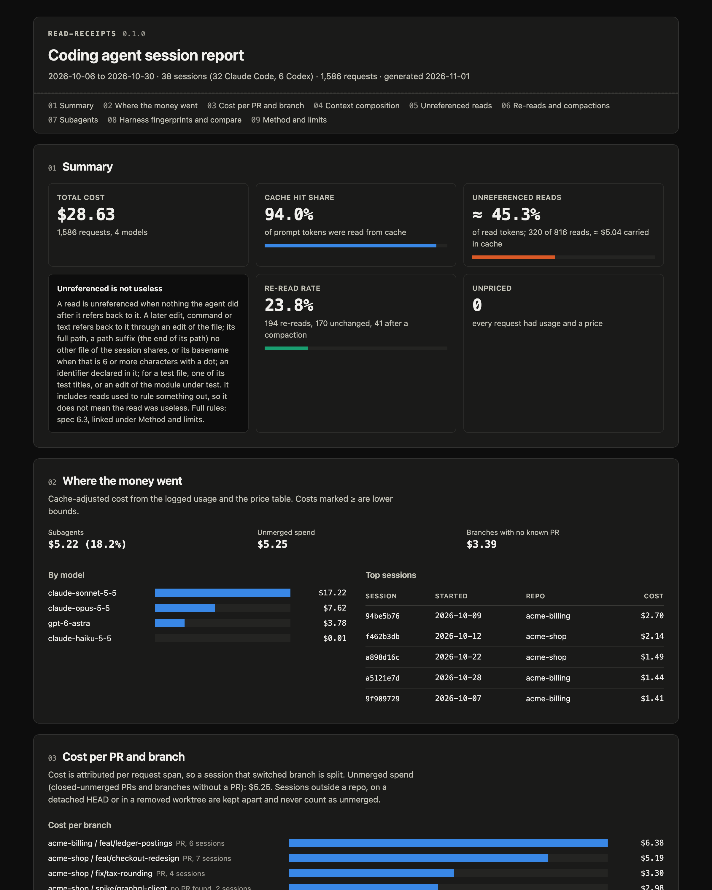

# read-receipts

Your coding agent reads many files to answer one question, and nothing tells you which of those reads it ever used.

## Why it exists

Most of what a coding agent costs is context that gets sent to the model again and again: the system prompt, tool schemas, instruction files and every file the agent has read so far. Tools already count tokens and cost per session, but none of them checks whether a file the agent read was ever referred to again. `read-receipts` reads the session logs that Claude Code and Codex already write and, for every read, checks whether a later edit, path or identifier refers back to it. The heuristic was checked against blind labels, and the error rates are published below.



*The [sample report](docs/sample-report.html) (read-receipts 0.1.0) is built from a fictional demo corpus by `npm run sample`. Its numbers are made up to show every section and are far from the measured corpus below.*

## Quick start

You need Node.js 20.19 or later. Nothing is installed globally; `npx` runs the release tarball.

```sh
RR=https://github.com/mateuszkania-im/read-receipts/releases/download/v0.1.0/read-receipts-0.1.0.tgz

npx $RR                                    # summary of the last 30 days, all agents
npx $RR --html report.html                 # self-contained HTML report
npx $RR --html report.html --share         # the same, redacted for sharing
npx $RR compare --by instructions          # sessions grouped by CLAUDE.md / AGENTS.md version
npx $RR prs --gh                           # cost per branch and PR, PR states from the gh CLI
```

Other commands: `sessions` (one row per session), `session <id-prefix>` (one session in detail) and `prices` (the price table in use). Common options: `--since 2w`, `--project <path>`, `--agent claude|codex`, `--json` (fields in [docs/json-schema.md](docs/json-schema.md)). `npx $RR --help` lists every option and command, one line each.

<!-- STUDY:START -->
### What we measured

One developer's Claude Code sessions in 4 allowlisted public repos: 351 sessions, measured with read-receipts 0.1.0 on 2026-11-02. Almost all are headless runs (entrypoints: sdk-py 271, sdk-cli 80), mostly code-review and benchmark sessions, so this is not a picture of interactive use. No Codex sessions.

| Measure | Value |
|---|---|
| Sessions (requests) | 351 (925) |
| Cost computed from token usage | $43.42 |
| Claude Code's own cost record | $44.18 (computed is 1.7% lower: harness calls without a transcript record) |
| Cache hit share of input tokens | 73.7% |
| Reads unreferenced | 72 of 268 (26.9%), ≈ 28.2% of read tokens |
| Labelled reads the heuristic calls unreferenced | 60: 11 unused, 24 used, 25 unclear |
| Re-read rate | 5.6% (15 re-reads, 14 of them unchanged) |
| Compactions, subagents | 0, 0 |

The labelled row counts reads of the first sample, which took every read then called unreferenced; it is a direct count, not an estimate.

### How good the read heuristic is

Reads from these sessions were labelled by an LLM reviewer with a written rubric, blind to the heuristic, as used, unused or unclear. Full method and tables: [docs/STUDY.md](docs/STUDY.md).

- **"Unreferenced" precision**, first sample, heuristic v1: 25.0% (11 of 44 reads called unreferenced were unused, 95% CI 14.6% to 39.4%). 149 reads labelled, 33 unclear.
- **"Referenced" miss rate**, held-out sample: 3.7% (3 of 81 were unused, 95% CI 1.3% to 10.3%), 8 unclear.
- The current heuristic (v2) adds two test-file rules that came from the first labels. On that development set its precision is 31.4% (95% CI 18.6% to 48.0%); that is a development set number, not a validation. The report uses the v1 figure.
- Recall is not published. The first sample was stratified: it took every read the heuristic calls unreferenced but only a subsample of the referenced ones, so recall cannot be estimated without reweighting by those sampling fractions, and an unweighted figure would overstate it.

In short: a referenced read was almost always used. Unreferenced is an upper bound on unused reads, not a count of wasted ones.
<!-- STUDY:END -->

## How it differs from other tools

Several tools already cover parts of this, and some of them came first:

- [tokentab](https://github.com/smerwin/tokentab) does cost per merged PR and "dead spend" on PRs that were closed or never opened. `read-receipts` does the same per branch and PR and borrows the idea.
- [token-dashboard](https://github.com/nateherkai/token-dashboard), [contextclues](https://github.com/MaxwellVolz/contextclues), [context-autopsy](https://github.com/AlistairClark7/context-autopsy) and [anthropometer](https://github.com/arian-shamaei/anthropometer) show repeated or duplicate reads and context composition.
- [ccusage](https://github.com/ccusage/ccusage) reports token usage and cost per day, session and model for many agents.

What `read-receipts` adds: a per-read test of whether anything the agent did later refers to the file, with the test's error rates measured against labels; re-reads of an unchanged file after a compaction as a measure of what the compaction lost, with no LLM call; and a fingerprint of the harness (instruction files, skills, hooks, MCP servers) per session, so `compare` can show cost and read numbers before and after a harness change. The full comparison is in [docs/novelty.md](docs/novelty.md).

## How to read the report

Every metric, with its exact definition in the [design spec](docs/superpowers/specs/2026-11-01-agent-ledger-design.md). Numbers marked `≈` use a token estimate of 4 characters per token.

- **Cost**: tokens of each request times the model's price, cache reads and writes priced separately; requests without usage or price are counted, never guessed ([6.1](docs/superpowers/specs/2026-11-01-agent-ledger-design.md#61-cost)).
- **Unlogged cost**: Claude Code's own cost record minus the computed cost, which is harness calls such as compaction that have no transcript record ([6.1](docs/superpowers/specs/2026-11-01-agent-ledger-design.md#61-cost)).
- **Cache hit share** (`cacheHitShare`): cache-read tokens divided by all input tokens ([6.1](docs/superpowers/specs/2026-11-01-agent-ledger-design.md#61-cost)).
- **Context composition**: tokens each source put into the context (introduced) and how often they were sent again (processed); the rest is unattributed ([6.2](docs/superpowers/specs/2026-11-01-agent-ledger-design.md#62-context-composition)).
- **Unreferenced read**: a read that no later edit, path mention or declared identifier refers back to. Unreferenced is an upper bound, not wasted ([6.3](docs/superpowers/specs/2026-11-01-agent-ledger-design.md#63-reads-and-unreferenced-reads)).
- **Unreferenced read rate and token share**: unreferenced reads over all reads, by count and by tokens (≈) ([6.3](docs/superpowers/specs/2026-11-01-agent-ledger-design.md#63-reads-and-unreferenced-reads)).
- **Unreferenced carried cost**: what it cost to keep unreferenced reads in the cached context until the next compaction or the end (≈) ([6.3](docs/superpowers/specs/2026-11-01-agent-ledger-design.md#63-reads-and-unreferenced-reads)).
- **Likely unused**: unreferenced reads times the measured precision, with a range scaled from the precision CI (low end rounded down, high end up; not a 95% interval for the count); an estimate, counted in reads, not tokens ([6.3](docs/superpowers/specs/2026-11-01-agent-ledger-design.md#63-reads-and-unreferenced-reads)).
- **Re-read rate**: reads of a file the same thread had already read, over all reads, split into unchanged and changed in between ([6.4](docs/superpowers/specs/2026-11-01-agent-ledger-design.md#64-re-reads)).
- **Compaction re-read rate**: files read before a compaction and read again, unchanged, after it, over the files read before it ([6.4](docs/superpowers/specs/2026-11-01-agent-ledger-design.md#64-re-reads)).
- **Harness fingerprint**: short hashes of the instruction files, skills, hooks, MCP servers, system prompt and model of a session ([6.5](docs/superpowers/specs/2026-11-01-agent-ledger-design.md#65-harness-fingerprint)).
- **Cost per branch and PR**: request cost grouped by git branch, matched to PRs with `--gh`, with attempts and unmerged spend ([6.6](docs/superpowers/specs/2026-11-01-agent-ledger-design.md#66-attribution-and-cost-per-branch-and-pr)).
- **Compare**: per fingerprint group, median and p90 cost per session and the read and cache numbers above; groups under 5 sessions are not compared ([6.7](docs/superpowers/specs/2026-11-01-agent-ledger-design.md#67-compare)).
- **Subagent cost share**: cost of subagent threads over the session cost; subagents count towards their parent session ([6.1](docs/superpowers/specs/2026-11-01-agent-ledger-design.md#61-cost)).

## Limits

- Token counts per source and every number marked `≈` are estimates. Costs come from the bundled price table and the usage the logs record.
- The read heuristic has measured error rates (above). Unreferenced reads include reads the agent used without naming anything from them.
- The study corpus is one developer's public-repo sessions, almost all headless review and benchmark runs. Error rates on interactive sessions may differ.
- The Codex parser is tested on synthetic fixtures and one local rollout; no Codex reads were labelled.
- The Claude Code log format is not a stable API. The parser is pinned to fixtures of version 2.1.316 and may need updates when the format changes.
- PR attribution matches branch names and dates; work on a reused branch name can be attributed to the wrong PR.

## Privacy

Everything runs on your machine. `read-receipts` reads the log folders, runs read-only `git` commands in the repos named by the logs, and makes no network call. The one exception is `--gh`, which asks the `gh` CLI for the repo's pull requests. There is no telemetry and no update check, and the HTML report loads nothing from the network. Working directories named in the logs are opened only when they are local absolute paths (a drive letter on Windows, a single leading `/` elsewhere): UNC, device and relative paths are skipped with a note, so a log cannot make `read-receipts` connect to a network share. One limit: a Windows drive letter mapped to a network share looks local and is not detected.

`--share` redacts the output (terminal, `--json` and `--html`) before any of it is written. It removes absolute paths, the home directory, prompts, assistant text, tool inputs and results, commands, PR titles and URLs, and working directories. Branch names, session ids, MCP server names and non-built-in tool names are replaced by short labels keyed with a random per-machine salt, so they stay stable for you and cannot be recovered by hashing common names. What remains is numbers, model names, built-in tool names, repo names, repo-relative paths, PR numbers and states, keyed fingerprint hashes and dates. Check a shared report before you post it.

## Development

```sh
npm ci
npm run typecheck && npm run lint && npm test
npm run build            # writes the standalone bundle bin/read-receipts.mjs
npm run check:bundle     # fails if the committed bundle is out of date
npm run perf             # 1 GB throughput check, local only
```

The validation study scripts are in [`study/`](study/). They only read sessions from the repos in `study/allowlist.json`, and their working files go to `study/.work/`, which is never committed. [docs/STUDY.md](docs/STUDY.md) describes how to rerun them.

## License

[MIT](LICENSE), Mateusz Kania.
